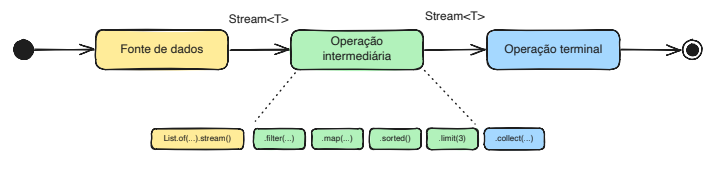
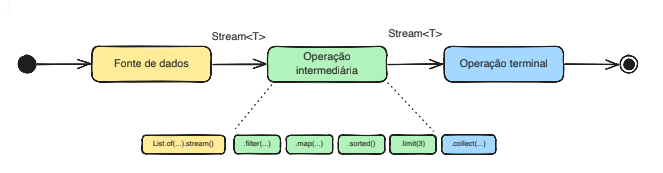

# Java Streams

## Paradigma de programação funcional

- O foco está em descrever o que queremos alcançar (declarativo), em vez de como realizar uma tarefa (imperativo).
- Enfatiza o uso de funções puras, imutabilidade e expressões lambda para criar código mais conciso, legível e fácil de manter.
- Java Streams é uma API para processar coleções de forma funcional.

## Stream

- **Stream** é uma sequência de elementos processada por operações intermediárias
encadeadas e finalizada por uma operação terminal
- Não armazena dados, apenas processa um fluxo proveniente de coleções, arrays,
arquivos, etc
- Não altera a fonte de dados, mas retorna um novo fluxo com os resultados das operações
- Permite processamento sequencial ou paralelo

## Exemplo de uso de Java Streams vs código imperativo

Deixar em maiúsculo o nome de todas as pessoas que iniciam com a letra “A”

`List<String> nomes = Arrays.asList("Ana", "Juca", "Maria", "Amanda");`

Exemplo de código imperativo

```java
List<String> resultado = new ArrayList<>();
for (String nome : nomes) {
    if (nome.startsWith("A")) {
        resultado.add(nome.toUpperCase());
    }
}
```

Exemplo de código usando Java Streams

```java
List<String> resultado = nomes.stream()
.filter(nome -> nome.startsWith("A"))
.map(String::toUpperCase).toList();
```

## Características do Java Streams

- **Sem armazenamento**, processa um fluxo de dados proveniente de uma fonte
- **Funcional por natureza**, operações intermediárias transformam o fluxo e retornam um novo fluxo
- **Consumível**, um fluxo só pode ser consumido uma vez, após a operação terminal, o fluxo é fechado e não pode ser reutilizado
- **Avaliação tardia** (lazy evaluation), a execução das operações intermediárias é adiada até que seu resultado seja necessário para a operação terminal, objetivando processamento eficiente

## Componentes do fluxo de execução do Java Strems

O fluxo de execução passa por uma ou mais operações intermediárias, que transformam os dados e retornam um novo fluxo, e termina em uma operação terminal, que produz um resultado ou efeito colateral.

- Efeito colateral: imprimir algo na tela, escrever em um arquivo, etc.



## Operações intermediárias

Algumas operações intermediárias comuns em Java Streams

### Sem estado (stateless)

Processam cada elemento independentemente

- filter(Predicate)
- map(Function)
- flatMap(Function)
- mapToInt / Long / Double
- limit(n)
- skip(n)

### Com estado (statefull)

Precisam ver elementos anteriores para decidir

- distinct()
- sorted(Comparator?)

Podem exigir armazenamento adicional para manter o estado, o que pode afetar a eficiência do processamento com grandes volumes de dados.

## Componentes do fluxo de execução do Java Strems



```java
List<Integer> numeros = Arrays.asList(1, 2, 3, 4, 5, 6);
numeros.stream() // Cria um fluxo de dados a partir da coleção
.filter(numero -> numero % 2 == 0) // Operação intermediária
.forEach(System.out::println); // Operação terminal
```

- Os dados fluem através de uma série de operações intermediárias, onde cada operação pode transformar os dados para depois serem processados por uma operação terminal.

## Alguns exemplos com Streams I

Operações intermediárias e terminais

Somar os números pares de uma lista

```java
List<Integer> lista = Arrays.asList(1, 2, , 4, 5, 6);

int soma = 0;

soma = lista.stream()
    .filter(numero -> numero % 2 == 0) // Filtra os números pares
    .mapToInt(Integer::intValue) // Converte para IntStream
    .sum(); // Soma os números

// Código imperativo equivalente
soma = 0;
for (Integer numero : lista) {
    if (numero % 2 == 0) {
        soma += numero;
    }
}
```

## Alguns exemplos com Streams II

Operações intermediárias e terminais

Obter o tamanho da maior palavra em uma lista de palavras

```java
List<String> lista = Arrays.asList("Java", "Stream", "API", "Collections");

// Usando lambda
int maior = lista.stream()
    .mapToInt(p-> p.length()) // Converte cada palavra para seu comprimento (int)
    .max() // Encontra o valor máximo entre os comprimentos
    .orElse(0); // Retorna 0 se a lista estiver vazia

// Outra forma de escrever usando referência de método
int maior = lista.stream()
    .mapToInt(String::length) // Converte cada palavra para seu comprimento (int)
    .max() // Encontra o valor máximo entre os comprimentos
    .orElse(0); // Retorna 0 se a lista estiver vazia
```

## Alguns exemplos com Streams III

Operações intermediárias e terminais

Descobrir a pessoa com o nome mais longo em uma lista de pessoas

```java
List<Pessoa> pessoas = Arrays.asList(new Pessoa("Ana", 40), new Pessoa("Juca", 30), new Pessoa("Maria", 25));

String nomeMaisLongo = pessoas.stream()
    .map(pessoa -> pessoa.getNome()) // Extrai os nomes das pessoas
    .max(Comparator.comparingInt(nome -> nome.length()))
    .orElse(""); // Retorna uma string vazia se a lista estiver vazia

// Outra forma de escrever usando referência de método
nomeMaisLongo = pessoas.stream().map(Pessoa::getNome)
    .max(Comparator.comparingInt(String::length)).orElse("");

// Código imperativo equivalente
String nomeMaisLongo = "";

for (Pessoa pessoa : pessoas) {
    if (pessoa.getNome().length() > nomeMaisLongo.length()) {
        nomeMaisLongo = pessoa.getNome();
    }
}
```

## Alguns exemplos com Streams IV

Operações intermediárias e terminais

```java
// Classe Pessoa com atributos nome, idade e país de origem
ArrayList<Pessoa> pessoas = new ArrayList<>();
pessoas.add(new Pessoa("Ana", 40, "Brasil"));
pessoas.add(new Pessoa("Juca", 30, "Brasil"));
pessoas.add(new Pessoa("Maria", 25, "Uruguai"));
Pessoa p = pessoas.stream()
    .filter(pessoa -> pessoa.getNome().equals("Maria")) // filtra
    .findFirst() // Retorna o primeiro elemento que atende a condição
    .orElse(null); // retorna null se não encontrar
if (p != null){ // se encontrou
    System.out.println(p);
}
```

## Alguns exemplos com Streams V

Operações intermediárias e terminais

```java
// Ordenando os elementos da lista por idade
pessoas.sort(Comparator.comparing(Pessoa::getIdade));
// Contando quantas pessoas tem idade maior que 30
long total = pessoas.stream()
    .filter(pessoa -> pessoa.getIdade() > 30) // filtra os elementos
    .count(); // Conta os elementos filtrados
// Contando quantas pessoas tem idade maior que 30 e país de origem Brasil
long totalBrasil = pessoas.stream()
    .filter(pessoa -> pessoa.getIdade() > 30) // filtra por idade
    .filter(pessoa -> pessoa.getPaisOrigem().equals("Brasil"))
    .count(); // Conta os elementos filtrados
```

## Alguns exemplos com Streams VI

Operações intermediárias e terminais

```java
// Montando uma lista com pessoas cujo país de origem seja "Brasil"
List<Pessoa> pessoasBrasil = pessoas.stream()
    .filter(pessoa -> pessoa.getPaisOrigem().equals("Brasil")).toList();

// Obtendo uma lista de nomes das pessoas com idade maior que 30
List<String> maioresDe30 = pessoas.stream()
    .filter(pessoa -> pessoa.getIdade() > 30)
    .map(Pessoa::getNome).toList(); // Coleta os nomes em uma nova lista

// Imprimindo os nomes das pessoas em caixa alta
pessoas.stream()
    .map(pessoa -> pessoa.getNome().toUpperCase())
    .forEach(System.out::println); // Exibe os nomes em caixa alta
```

## Exercícios

Casamento de chaves, colchetes e parênteses

• Verifique se o casamento de parênteses, colchetes e chaves está correto em uma
expressão matemática
• Exemplo: −{[b × b − (4 × a × c)]/(2 × a)}
• Algoritmo:
• Use uma pilha para armazenar os símbolos de abertura
• Para cada símbolo na expressão:
• Se for um símbolo de abertura, empilhe-o
• Se for um símbolo de fechamento, desempilhe o último símbolo de abertura e verifique se ele
corresponde ao símbolo de fechamento
• Se não corresponder ou se a pilha estiver vazia, a expressão é inválida
• Se a pilha estiver vazia no final, a expressão é válida; caso contrário, é inválida

## Referências

SILVA, Carlos. Java 8: Iniciando o desenvolvimento com a Streams API. 2016. Disponível em:
[https://www.oracle.com/br/technical-resources/articles/java-stream-api.html](https://www.oracle.com/br/technical-resources/articles/java-stream-api.html).
