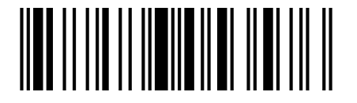

# Sistema de cadastro de livros

Desenvolva um sistema que permita gerenciar um coleção de livros. Todo livro deve ter os seguintes atributos: ISBN, título, autor e ano de publicação. O ISBN deve ser único para cada livro e não pode ser alterado após o cadastro. Assim, é possível cadastrar livros com o mesmo título, autor ou ano de publicação, mas não é permitido cadastrar dois livros com o mesmo ISBN. O sistema deve permitir ao usuário, por meio de
um menu, realizar as seguintes operações:

1. Cadastrar um livro;
2. Listar somente ISBN e título de todos os livros cadastrados;
3. Consultar um livro pelo ISBN e exibir seus dados
4. Consultar livros por autor e exibir somente ISBN e título;
5. Consultar livros por ano de publicação e exibir somente ISBN e título;
6. Atualizar os dados de um livro, exceto o ISBN;
7. Remover um livro;
8. Sair do sistema.

## 2 Uso de biblioteca de terceiros

A biblioteca Zxing Core (https://github.com/zxing/zxing) permite gerar códigos de barra 1D e 2D QRCode e está disponível via Maven Central (https://mvnrepository.com/artifact/com.google.zxing). Para usar essa biblioteca no seu projeto é necessário incluir a seguinte linha na seção de dependências do seu arquivo build.gradle.kts

```java
implementation("com.google.zxing:core:3.5.4")
```

No exemplo abaixo é apresentado o uso dessa biblioteca para gerar um código de barras no formato
EAN13 (https://pt.wikipedia.org/wiki/EAN-13) para representar o ISBN de um livro.


```java
public class App{
    // Veja que esse método main encaminha uma exceção.
    public static void main(String[] args) throws Exception{
        int largura = 105;
        int altura = 5;
        String isbn = "9788576053576";
        EAN13Writer writer = new EAN13Writer();
        // Gera a matriz de bits para o formato EAN_13
        BitMatrix bitMatrix = writer.encode(isbn, BarcodeFormat.EAN_13, largura, 1);
        // Renderiza o código de barras usando blocos cheios █ e espaços em branco
        // https://www.unicodepedia.com/unicode/block-elements/2588/full-block/
        for (int i = 0; i < altura; i++) {
            for (int x = 0; x < bitMatrix.getWidth(); x++) {
                if (bitMatrix.get(x, 0)) {
                    System.out.print("\u2588");
                } else {
                    System.out.print(" ");
                }
            }
            System.out.println(); // Quebra de linha para a próxima camada da barra
        }
        System.out.println("ISBN-13: " + isbn);
    }
}
```

Figura 1 Representação do ISBN 9788576053576 em código de barra EAN13:

