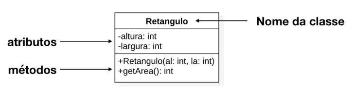
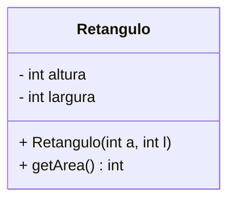
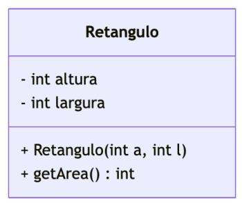

# Diagrama de classes UML

## UML: Linguagem de modelagem unificada

- Linguagem (notação gráfica + semântica) para especificar, construir e documentar os
artefatos dos sistemas
- Formas de uso para a UML
- Como rascunho – diagramas incompletos e informais (geralmente escritos em um quadro
branco) para explorar partes difíceis do problema
- Como projeto de software – diagramas detalhados que podem ser usados para gerar código
(engenharia direta) ou foram gerados para entender um código existente (engenharia reversa)

## Diagramas da UML

Diagramas estruturais

- Diagrama de classes
- Diagrama de objetos
- Diagrama de componentes
- Diagrama de implantação

Diagramas comportamentais

- Diagrama de caso de uso
- Diagrama de sequência
- Diagrama de colaboração
- Diagrama de atividades

## Diagrama de classes

Representa a estrutura estática de um sistema orientado a objetos, mostrando as classes, seus atributos, métodos e os relacionamentos entre elas

- não precisam ser completos, podem ser usados para destacar somente as partes mais importantes do sistema

- Na fase de análise de requisitos, é usado para modelar as entidades do domínio do problema e seus relacionamentos
- Na fase de projeto, é usado para modelar as classes do sistema, seus atributos, métodos e os relacionamentos entre elas
- Na fase de manutenção, é usado para entender o código existente e para planejar alterações no sistema

### Representação de classes em um diagrama de classes UML

- Modificadores de acesso (+, −, #)
- Membros estáticos ficam sublinhados
- Métodos triviais (getters e setters) devem ser omitidos para manter o diagrama mais legível

## Modelagem de classes

- **Perspectiva conceitual:** As classes representam conceitos do domínio do problema
- **Perspectiva de implementação:** As classes representam as classes do código-fonte do sistema

## Ferramentas de modelagem UML

- [Mermaid](https://mermaid.ai/live)
  - É uma ferramenta gratuita para criar diagramas a partir de texto
- [PlantUML](https://plantuml.com)
- [PlatumlEditor](https://plantumleditor.com/webedit/)
  - É uma ferramenta gratuita para criar diagramas a partir de texto
- [Draw.io](https://www.drawio.com)
  - Ferramenta gratuita e de propósito geral para criar diagramas, incluindo diagramas UML
  - Permite criar diagramas de forma visual, arrastando e soltando elementos, sem a necessidade de escrever código
- [StarUML](http://staruml.io)
  - Ferramenta comercial para modelagem UML, com suporte a uma ampla variedade de diagramas e recursos avançados de modelagem

## Mermaid

Documentação https://mermaid.js.org/syntax/classDiagram.html

