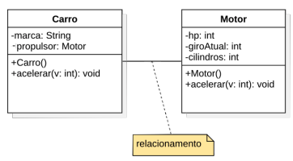
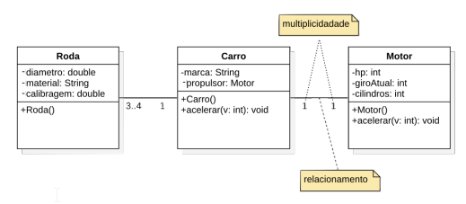
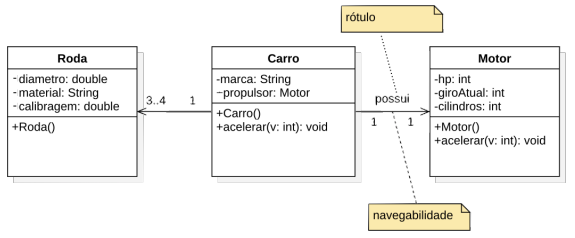
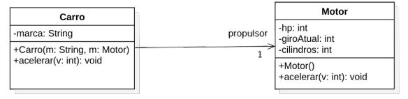
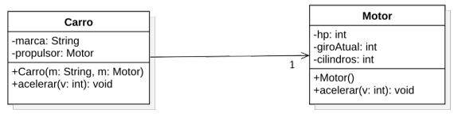
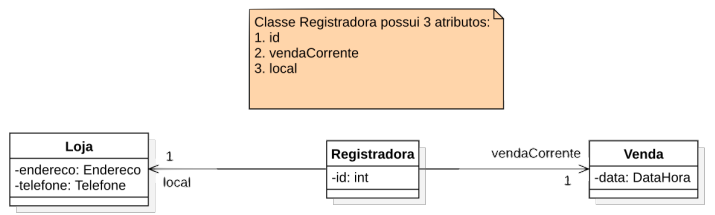
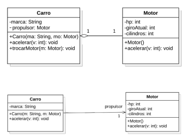
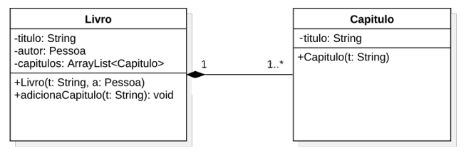
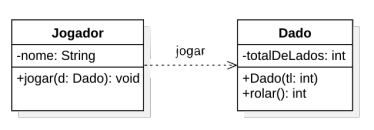

# Associação entre classes

- Relacionamento entre classes que permite o compartilhamento de informação e colaboração para a execução de computação
- Descreve o vínculo entre objetos de uma ou mais classes
- A classe Carro possui um relacionamento com a classe Motor, pois um objeto da classe Carro contém 1 objeto da classe Motor

```java
public class Carro{
    private String marca;
    private Motor propulsor;
    public Carro(String m, Motor mo){
        this.marca = m;
        this.propulsor = mo;
    }
}
```



## Multiplicidade em associações entre classes



- `0..*` - Zero ou mais
- `1..*` - Um ou mais
- `*` - Muitos
- `1` - Exatamente um
- `3..4` - De 3 a 4

## Associação unidirecional

Representada por uma linha com uma seta apontando para a classe que é referenciada

- A classe Carro tem uma referência para um objeto da classe Motor, mas a classe Motor não tem uma referência para um objeto da classe Carro
- A classe Carro pode acessar os membros públicos do objeto da classe Motor, mas a classe Motor não pode acessar os membros públicos do objeto da classe Carro.



## Associação: notação textual vs linha de associação

- Uso da notação de associação para indicar que Carro possui uma referência para uma instância de Motor



- Notação textual de atributo



## Associação: notação textual vs linha de associação



## Associação do tipo Agregação

- Representa uma relação onde uma classe (todo) agrupa outras classes (partes), mas as partes podem existir independentemente do todo
- Usada quando o ciclo de vida dos objetos-parte não depende do objeto-todo.

- **Exemplos**



- Um carro possui um motor. Se o carro deixar de existir, o motor poderia ser colocado em
outro carro
- Um livro possui um autor. Se o livro deixar de existir, o autor ainda pode existir e escrever
outros livros

- Representada por uma linha de associação com um losango vazio na extremidade do lado do objeto-todo
- Pode ser representada por uma linha de associação comum, sem a necessidade de usar a notação de losango para indicar a agregação

```java
public class Carro{
    private String marca;
    private Motor propulsor;
    public Carro(String m, Motor mo){
        this.marca = m;
        this.propulsor = mo;
    }
    public void acelerar(int valor){
        this.propulsor.acelerar(valor);
    }
    public void trocarMotor(Motor mo){
        this.propulsor = mo;
    }
}
```

## Associação do tipo Composição

- A composição representa uma relação de “todo-parte” onde a parte pertence exclusivamente ao todo.
- Se o objeto-todo for destruído, todos os seus objetos-parte também são destruídos automaticamente.
- Os objetos-parte não podem existir independentemente do objeto-todo; sua existência está totalmente vinculada ao ciclo de vida do todo.

### Exemplos

- Um objeto Livro é composto por diversos objetos Capítulo. Se destruirmos um Livro, não faria mais sentido os Capítulos existirem
- Um objeto Aluno pode ser composto por um objeto Endereço. Se destruirmos o objeto Aluno, não faria mais sentido o objeto Endereço existir

- Representada por uma linha de associação com um losango preenchido na extremidade do lado do objeto-todo
- Indica que a classe-todo é responsável por criar e destruir os objetos-parte, ou seja, o ciclo de vida dos objetos-parte é controlado pelo objeto-todo



```java
public class Livro{
    private String titulo;
    private ArrayList<Capitulo> capitulos;
    private Pessoa autor;
    public Livro(String t, Pessoa a){
        this.titulo = t;
        this.capitulos = new ArrayList<>();
        this.autor = a;
    }
    public void adicionaCapitulo(String titulo){
        this.capitulos.add(new Capitulo(titulo));
    }
}
```

- Os objetos da classe Capítulo são criados e destruídos pelo objeto da classe Livro
- Não há referências para os objetos da classe Capítulo fora do objeto da classe Livro, ou seja, os objetos da classe Capítulo não podem existir
independentemente do objeto da classe Livro

## Associação do tipo Dependência

- Indica que uma classe utiliza temporariamente outra para realizar uma tarefa
- Mudanças na classe utilizada podem impactar a classe dependente, mas mudanças na classe dependente não impactam a classe utilizada

Exemplo

- O jogador precisa de um dado para obter um resultado de uma jogada, mas o dado não faz parte do jogador, ou seja, o dado não é um atributo do jogador



```java
public class Jogador {
    private String nome;
    public void jogar(Dado dado){
        int resultado = dado.rolar();
    }
}
```

## Exercícios

Faça um diagrama de classes UML para um jogo

- Cada Avião deve possuir:
  - Número máximo de tripulantes
  - Número máximo de passageiros
  - Capacidade máxima de combustível
- Um avião pode ter de 1 a 8 Motores
- Cada Motor pode ser do tipo turbina ou hélice
  - Cada motor pode estar ligado ou desligado
- Ao ligar o avião, todos os motores devem ser ligados. Ao desligar o avião, todos os motores devem ser desligados
- É possível ligar ou desligar cada motor individualmente

## Referências

- Craig Larman - Utilizando UML e padrões - 3a. Edição - Editora Bookman, 2007
Capítulos 16, seções: 16.1 – 16.9, 16.10, 16.13

- Gilleanes T.A. Guedes - UML2 – uma abordagem prática - 2a. Edição - Editora Novatec, 2011
Capítulos 4, seções: 4.1–4.2.2, 4.2.4, 4.2.5, 4.2.8

- Aulas baseadas em Craig Larman - Utilizando UML e padrões - 3a. Edição - Editora Bookman, 2007
