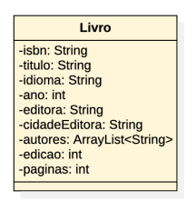
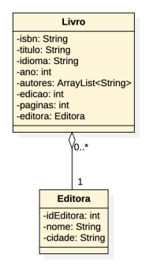
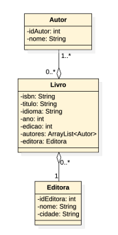
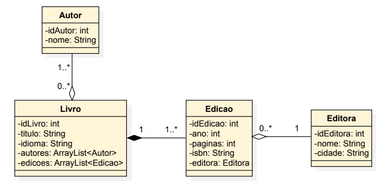
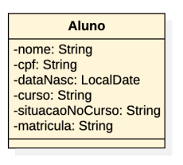
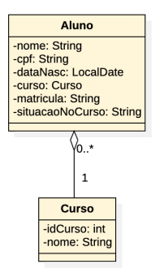
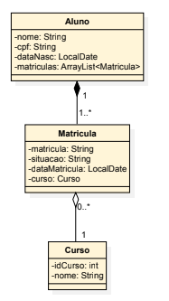
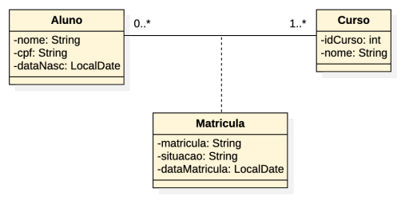

# Modelando entidades e relacionamentos

- A modelagem de entidades e relacionamentos define a estrutura dos dados e as interações entre eles
- Indica quais informações são relevantes para o sistema, ou seja, quais informações serão armazenadas e manipuladas

- Entidade é um objeto do mundo real que é distinguível de todos os outros objetos
  - Aluno “Juca”
  - Livro “Utilizando UML e padrões”

- Relacionamento é uma associação entre duas ou mais entidades
  - Juca possui Matrícula no Curso X
  - Utilizando UML e padrões escrito por Craig Larman

- Atributos são propriedades de uma entidade ou de um relacionamento
  - Todo Aluno tem nome
  - Todo Livro tem título, ISBN
  - O relacionamento “Aluno possui Matrícula em Curso” tem o atributo data de matrícula
  - O relacionamento “Livro escrito por Autor” tem o atributo ordem de autoria

- Em linguagens orientadas a objetos, as entidades são instâncias de classes, os atributos são variáveis de instância e os relacionamentos são associações entre classes
- A modelagem de entidades e relacionamentos pode ser representada por meio de diagramas de classes UML

> Nota
> Frameworks de Mapeamento Objeto-Relacional (ORM, Object-Relational Mapping) permitem mapear as classes do sistema para tabelas em um banco de dados relacional, facilitando a persistência dos dados

## Sistema para gestão de livros

- A classe Livro deve representar uma entidade do mundo real, ou seja, um livro
- Os atributos são as informações que serão armazenadas sobre cada livro
- O livro não deve ter atributos que não sejam dele, ou seja, que sejam de outras entidades ou ainda de relacionamentos entre entidades
- Quais propriedades não são da entidade livro?
- Para um livro é importante saber o nome da editora
- A cidade da editora não é uma propriedade do livro, mas sim da editora
- Uma editora pode publicar vários livros

> Um relacionamento entre as classes Livro e Editora para representar essa associação seria um modelo mais adequado do que colocar o nome da editora como um atributo do livro

- Para um livro é importante saber o nome da editora
- A cidade da editora não é uma propriedade do livro, mas sim da editora
- Uma editora pode publicar vários livros

> Um relacionamento entre as classes Livro e Editora para representar essa associação seria um modelo mais adequado do que colocar o nome da editora como um atributo do livro

- Um Livro pode ter vários autores e um Autor pode ter escrito vários livros
- Sobre o Autor, é importante registrar mais informações além do nome, como por exemplo a data de nascimento, nacionalidade, etc

> Um relacionamento entre as classes Livro e Autor para representar essa associação seria um modelo mais adequado

- Um Livro pode ter vários autores e um Autor pode ter escrito vários livros
- Sobre o Autor, é importante registrar mais informações além do nome, como por exemplo a data de nascimento, nacionalidade, etc

> Um relacionamento entre as classes Livro e Autor para representar essa associação seria um modelo mais adequado

- Cada livro pode ter várias edições
- Cada edição tem um ISBN, um número de páginas e um ano de publicação
- Cada edição pode ser publicada por uma editora diferente

> Vamos praticar! Ajuste o diagrama para representar as edições dos livros, considerando os atributos de cada edição e a editora responsável por cada edição

## Um modelo possível para o sistema de gestão de livros

## Sistema acadêmico

- Existem propriedades que são de outras entidades ou ainda de relacionamentos entre entidades?
- curso, que guarda o nome do curso, não é uma propriedade de Aluno, mas sim de Curso
- Um Curso pode ter vários alunos

- curso, que guarda o nome do curso, não é uma propriedade de Aluno, mas sim de Curso
- Um Curso pode ter vários alunos
- É importante registrar a data da matrícula do aluno no curso
- Um aluno pode fazer vários cursos
- A situação do aluno no curso não é uma propriedade do aluno, mas sim de sua matrícula

- É importante registrar a data da matrícula do aluno no curso
- Um aluno pode fazer vários cursos
- A situação do aluno no curso não é uma propriedade do aluno, mas sim de sua matrícula

## Classe de associação

- A associação entre classes pode ser redefinida por uma nova classe a qual terá atributos próprios
- Adequada quando os atributos não pertecem a nenhuma das classes envolvidas na associação, mas à associação em si

