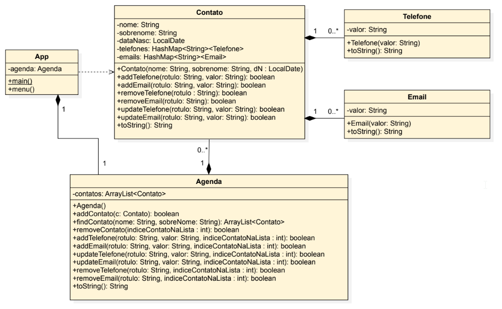

# Princípio da responsabilidade única

[Single Responsibility Principle (SRP)](https://blog.cleancoder.com/uncle-bob/2014/05/08/SingleReponsibilityPrinciple)

> “Ao escrever um módulo de software, você deve se lembrar de que ele deve ter uma e apenas uma razão para mudar, isto é, uma responsabilidade. Essas mudanças só podem ser solicitadas por uma única pessoa (Stakeholder)” – Robert C. Martin, Uncle Bob

- Cada classe deve ser responsável por uma pequena parte da funcionalidade de um software
- A responsabilidade deve estar completamente encapsulada dentro da classe
- Dividir um sistema em partes que cada uma é responsável por uma preocupação diferente
- Cada parte é desenvolvida, testada e mantida separadamente
- Isso facilita a manutenção, reutilização e evolução do sistema

Exemplos

- Um sistema acadêmico pode ser dividido em módulos para gerenciar alunos, disciplinas, livros, etc
- Um sistema web pode ser dividido em módulos para gerenciar a interface com o usuário, a lógica de negócios e o armazenamento de dados

## Exemplo: Sistema para gestão de Agenda telefônica

### Requisitos e regra de negócio

- O sistema deve permitir ao usuário gerenciar uma agenda telefônica, onde é possível armazenar informações de contatos pessoais e profissionais
- Adicionar, Remover, Atualizar, Listar dados de um contato, Listar todos contatos
- Todo contato deve possuir:
- Nome, Sobrenome, Data de nascimento, Telefone(s) e email(s)
- Todo telefone ou email deve possuir um rótulo de identificação (p. ex. celular, comercial, pessoal) e um valor (p. ex. pessoal: `juca@example.com`)
- Não deve ser permitido adicionar um email que não seja válido
- Os telefones devem ser exibidos formatados, no formato internacional: Ex: +55048998761234 → +55 (48) 9 9876-1234
- Ao listar os contatos, deve-se exibir o nome completo, data de nascimento, telefone(s) e email(s) de cada contato
- Os telefones e emails devem ser exibidos com o rótulo de identificação

Seguindo o princípio da responsabilidade única, como você modelaria o sistema?

> Vamos praticar! Faça um diagrama de classes UML com somente os nomes das classes que serão necessárias, bem como suas associações

### Quantas classes serão necessárias?

- App, Agenda, Contato, Email e Telefone



## Material de apoio

### Classes java.time.LocalDate e java.time.LocalDateTime

- java.time.LocalDate

```java
import java.time.Month;
//.....
// Dia de hoje
LocalDate hoje = LocalDate.now();
// Criando objeto com uma data específica
LocalDate dataEspecifica = LocalDate.of(2020, Month.JANUARY, 10);
```

- java.time.LocalDateTime

```java
import java.time.format.DateTimeFormatter;
//.....
String dHF;
LocalDateTime dataHora = LocalDateTime.of(2019, 04, 22, 13, 30, 00);
dhF = dataHora.format(DateTimeFormatter.ofPattern("yyyyMMdd'T'HHmmss"));
System.out.printf(dHF); // Será impresso: 20190422T133000
// para obter a data e hora no momento que essa linha foi executada
LocalDateTime agora = LocalDateTime.now();
```

### Classes LocalDate2 e DateTimeFormatter3

Para converter String para formato de data

```java
Scanner teclado = new Scanner(System.in);
// O usuário informa a data no formato dd/mm/aaaa
System.out.print("Entre com a data (dd/mm/aaaa): ");
String dataString = teclado.nextLine();
// Formato da data - d representa dia, M representa mês e y representa ano
DateTimeFormatter formato = DateTimeFormatter.ofPattern("dd/MM/yyyy");
// Converte a String para LocalDate, considerando o formato informado na String
LocalDate data = LocalDate.parse(dataString, formato);
// Exibe a data no formato padrão que é yyyy-MM-dd
System.out.println("Data: " + data);
// Exibe a data no formato informado pelo objeto formato
System.out.println("Data: " + data.format(formato));
```

2 - [https://docs.oracle.com/javase/tutorial/datetime/iso/index.html]
3 - [https://docs.oracle.com/javase/8/docs/api/java/time/format/DateTimeFormatter.html]

### Expressão regular (regex)

```plaintext
. Casa com qualquer caractere
[] Lista de caracteres. Ex: n[aã]o casa com não e nao. É possível definir
intervalos [0-2] casa com 0, 1 ou 2
̂ Casa com o começo da cadeia de caracteres
$ Casa com o final da cadeia de caracteres
* Casa o elemento precedente zero ou mais vezes. Ex: ab*c casa com ac,
abc, abbbbc
+ Casa o elemento precedente um ou mais vezes
? Torna o elemento precedente opcional
! Negação. Ex: n[!a] casa com n, mas não com na, nem não
\ Para escapar outros metacaracteres.
{n,m} De n até m. Ex: 2, pelo menos 2 caracteres
() Grupo. Ex: (www\.)?ifsc.edu.br casa com www.ifsc.edu.br e ifsc.edu.br
\w Corresponde a [a-zA-Z_0-9]
```

Exemplos em java

```java
// Para garantir que somente números sejam digitados
String eR = "^[0-9]+$";
String numero = "1234567890";
System.out.println("Número válido? " + numero.matches(eR));
// Para garantir que somente letras sejam digitadas
String eR = "^[a-zA-Z]+$";
String letras = "abcde";
System.out.println("Letras válidas? " + letras.matches(eR));
// Para garantir que somente letras e números sejam digitados
String eR = "^[a-zA-Z0-9]+$";
String alfanumerico = "abc123";
System.out.println("Alfanumérico válido? " + alfanumerico.matches(eR));
// Para não permitir caracteres repetidos e que tenha pelo menos 8 caracteres
String eR = "^(?!.*(.)\\1{2,})[a-zA-Z0-9]{8,}$";
String senha = "abc12345";
System.out.println("Senha válida? " + senha.matches(eR));
```

### Regex - Exemplo de validação de email

```java
String eR = "^[\\w-\\+]+(\\.[\\w]+)*@[\\w-]+(\\.[\\w]+)*(\\.[a-z]{2,})$";
String email = "meu.email@dominio.com.br";
System.out.println("Email válido? " + email.matches(eR));
```

• [https://docs.oracle.com/javase/tutorial/essential/regex/]
• [https://docs.oracle.com/javase/8/docs/api/java/util/regex/Pattern.html]

### Classe MaskFormatter

- A classe MaskFormatter é usada para formatar e editar Strings
- A máscara indica quais são os caracteres válidos que podem estar contidos na String

`MaskFormatter mask = new MaskFormatter("(##) #####-####");`

```plaintext
Símbolo Descrição
# Qualquer número
U Qualquer caractere e todos serão convertidos para maiúsculo
L Qualquer caractere e todos serão convertidos para minúsculo
A Qualquer caractere ou número
? Qualquer caractere
* Qualquer coisa
H Qualquer hexadecimal (0-9, a-f ou A-F)
```

### Exemplo com classe MaskFormatter

```java
public String formata(String mascara, String valor){
    MaskFormatter mask = null;
    String resultado = "";
    try {
        mask = new MaskFormatter(mascara);
        mask.setValueContainsLiteralCharacters(false);
        mask.setPlaceholderCharacter('_');
        resultado = mask.valueToString(valor);
    } catch (ParseException e) {
        e.printStackTrace();
    }
        return resultado;
}

public static void main(String[] args) {
    App p = new App();
    System.out.println(p.formata("(##) #####-####", "48998765432"));
}
```

## Referências

Robert C. Martin
Código limpo: Habilidades práticas do Agile Software
1a. Edição - Editora Alta Books, 2009
[https://app.minhabiblioteca.com.br/reader/books/9788550816043]

Robert C. Martin
Arquitetura Limpa: O guia do artesão para estrutura e design de software
1a. Edição - Editora Alta Books, 2019
[https://app.minhabiblioteca.com.br/reader/books/9788550808161]

Craig Larman
Utilizando UML e padrões
3a. Edição - Editora Bookman, 2007
